# Current navigation graph

**Snapshot:** 2026-10-14 · product tree `f25855f`, merged to `main` as
`8ae3d17` by PR #46.

This is a visual inventory of the navigation implemented by
[`SelloAppRoot`](../../app/src/main/java/com/software/sello/navigation/SelloApp.kt)
and [`Routes.kt`](../../app/src/main/java/com/software/sello/navigation/Routes.kt).
It is a current-state reference for UI/UX work, not a proposed graph. Update this
file when a destination, entry point, Back rule or screen-level composable changes.

## How to read the graph

- A solid box is a typed Navigation Compose destination.
- A dashed box is shell state, local UI state or a decision; it is not a route and
  does not create a back-stack entry.
- A rounded box is outside the production navigation graph.
- Every typed detail/form destination returns to the destination that opened it when
  it closes. Those Back edges are omitted from the graph to keep it readable.

```mermaid
flowchart LR
    launch([Application starts]) --> store{Financial store opens?}
    store -- No --> failure([Startup failure<br/>StartupFailureRoot → StartupFailureScreen])
    store -- Yes --> recibo[ReciboRoute<br/>ReciboDestination → ReciboScreen]

    recibo <-->|Recibo / Resumen tabs| resumen[ResumenRoute<br/>ResumenRoot → ResumenScreen]
    recibo -->|gear| settings[SettingsRoute<br/>SettingsRoot → SettingsScreen]
    recibo -->|add category| categoryCreate[CategoryEditorRoute<br/>CategoryEditorRoot → CategoryEditorScreen]
    recibo -.->|open category| reciboDetail[Recibo category detail<br/>ShellState.detailCategoryId<br/>CategoryDetailScreen]

    reciboDetail -->|edit category| categoryEdit[CategoryEditRoute<br/>CategoryManagementRoot → CategoryEditorScreen]
    reciboDetail -->|edit expense| expenseEdit[ExpenseEditRoute<br/>ExpenseEntryRoot → ExpenseEntryScreen]

    resumen -->|income line / Ver ingresos| incomeHistory[IncomeHistoryRoute<br/>IncomeHistoryScreen]
    resumen -->|category bar / row| resumenDetail[ResumenCategoryRoute<br/>CategoryDetailScreen]
    resumen -->|empty-state Anotar gasto| expenseEntry
    incomeHistory -->|Anotar ingreso| incomeEntry[IncomeEntryRoute<br/>EntryDestination, income first]
    incomeHistory -->|select income| incomeEdit[IncomeEditRoute<br/>IncomeFormRoot → IncomeFormScreen]
    resumenDetail -->|edit category| categoryEdit
    resumenDetail -->|edit expense| expenseEdit

    recibo -.->|global Anotar| entryRequest
    reciboDetail -.->|Anotar aquí| entryRequest
    resumen -.->|global Anotar| entryRequest
    resumenDetail -.->|global Anotar| entryRequest
    resumenDetail -->|Anotar aquí| expenseEntry
    settings -.->|global Anotar| entryRequest
    incomeHistory -.->|global Anotar| entryRequest
    deepLink([sello://anotar<br/>optional categoria + monto]) -.-> entryRequest[Pending expense request<br/>ShellState]
    entryRequest --> active{Active category exists?}
    active -- Yes --> expenseEntry[ExpenseEntryRoute<br/>EntryDestination, expense first]
    active -- No --> prerequisite[CategoryEditorRoute forEntry = true<br/>CategoryEditorRoot → CategoryEditorScreen]
    prerequisite -->|category created| expenseEntry

    expenseEntry --> expenseMode[ExpenseEntryRoot → ExpenseEntryScreen]
    incomeEntry --> incomeMode[IncomeFormRoot → IncomeFormScreen]
    expenseMode <-.->|Gasto / Ingreso switch<br/>local rememberSaveable state| incomeMode
    expenseMode -->|create a category| categoryCreate

    recibo -->|category secondary action| categoryEdit

    classDef route fill:#eef2ff,stroke:#3346a8,stroke-width:2px,color:#111;
    classDef local fill:#fffaf0,stroke:#9a6700,stroke-width:2px,stroke-dasharray:5 5,color:#111;
    classDef outside fill:#f6f8fa,stroke:#57606a,stroke-width:2px,color:#111;
    class recibo,resumen,settings,categoryCreate,categoryEdit,expenseEdit,incomeHistory,resumenDetail,incomeEntry,incomeEdit,prerequisite,expenseEntry route;
    class reciboDetail,entryRequest,active,expenseMode,incomeMode local;
    class launch,failure,deepLink outside;
```

The expense/income switch deserves special attention: both `ExpenseEntryRoute` and
`IncomeEntryRoute` enter the private `EntryDestination` host with a different initial
mode. Switching mode only changes `rememberSaveable` state inside that host. It does
not navigate to the other typed route. Expense and income edit routes bypass the
switch and open their corresponding form directly.

The month picker is another global state surface rather than a route. On every shell
destination, `ShellState.monthPickerOpen` shows `MonthPicker` as a bottom sheet or a
wide-window side panel. Back closes it before any detail or route is left.

## Destination and composable map

The feature-local column names the composables that assemble each screen. The shared
column names the main design-system composables used together there; ordinary Compose
layout primitives are intentionally omitted.

| Screen or surface | Route and host composables | Feature-local composables | Main shared composables |
| --- | --- | --- | --- |
| Startup failure | Outside graph: `StartupFailureRoot` → `StartupFailureScreen` | `Explanation`, `Warning` | `SelloScaffold`, `Slip`, `FormField`, `FieldMessageText`, `SelloButton` |
| Recibo | `ReciboRoute` → `SelloAppRoot` → `ReciboDestination` → `ShellScreen` → `ReciboScreen` | `SummarySlip`, `CategoriesSlip`, `FigureHeader`, `StaleSlip` | `Slip`, `CategoryGrid`, `CategoryCell`, `MoneyText`, `LeaderLine`, `Stamp`, `SlipSkeleton`, `EmptySlip`, `ErrorSlip`, `SelloButton` |
| Recibo category detail | No route; `ReciboDestination` supplies `ShellDetail` to `ShellScreen` → `CategoryDetailScreen` | `HeaderSlip`, `Expenses`, `ExpenseList`, plus shared `FigureHeader` and `StaleSlip` | `Slip`, `CategoryCircle`, `ActionLine`, `LeaderLine`, `MoneyText`, `SelloNotice`, `SlipSkeleton`, `EmptySlip`, `ErrorSlip`, `SelloButton` |
| Resumen | `ResumenRoute` → `ShellScreen` → `ResumenRoot` → `ResumenScreen` | `ResumenPane`, `SummarySlips`, `ChartSlips`, `ResumenHeading`, `ChartWidth` | `Slip`, `MoneyText`, `LeaderLine`, `Stamp`, `LineChart`, `ColumnsChart`, `SlipSkeleton`, `EmptySlip`, `ErrorSlip`, `SelloButton` |
| Resumen category detail | `ResumenCategoryRoute(categoryId)` → `ShellScreen` → `CategoryDetailScreen` | Same category-detail composables as above | Same category-detail shared composables as above |
| Income history | `IncomeHistoryRoute` → `ShellScreen` → `IncomeHistoryScreen` | The route creates `IncomeHistoryViewModel`; there is no separate root composable | `Slip`, `LeaderLine`, `MoneyText`, `SlipSkeleton`, `ErrorSlip`, `SelloButton` |
| New expense | `ExpenseEntryRoute(categoryId, amount)` → `EntryDestination` → `ExpenseEntryRoot` → `ExpenseEntryScreen` | `Pane`, `Stacked`, `ControlsPane`, `Draft`, `Said`, `Keys`, `PreviewRow`, `Receipt`, `DayPicker` | `SelloScaffold`, `Slip`, `AmountField`, `AmountKeypad`, `ChipFlow`, `SelloChip`, `SegmentedSwitch`, `FieldPill`, `FormField`, `TearLine`, `LeaderLine`, `TotalLine`, `MoneyText`, `Stamp`, `ConfirmSlip`, `SelloNotice`, `SelloButton` |
| Edit expense | `ExpenseEditRoute(expenseId)` → `ExpenseEntryRoot` → `ExpenseEntryScreen` | Same expense composables; the kind switch is omitted | Same expense shared composables as above |
| New income | `IncomeEntryRoute` → `EntryDestination` → `IncomeFormRoot` → `IncomeFormScreen` | `IncomePane`, `IncomeDraft`, `IncomeControls`, `IncomeDatePicker` | `SelloScaffold`, `Slip`, `AmountField`, `AmountKeypad`, `ChipFlow`, `SelloChip`, `SegmentedSwitch`, `FormField`, `MoneyText`, `Stamp`, `ConfirmSlip`, `SelloButton` |
| Edit income | `IncomeEditRoute(incomeId)` → `IncomeFormRoot` → `IncomeFormScreen` | Same income composables; the kind switch is omitted | Same income shared composables as above |
| Create category | `CategoryEditorRoute(forEntry)` → `CategoryEditorRoot` → `CategoryEditorScreen` | `Form`, `LimitFields`, `SectionLabel`; `ArchiveConfirmation` is edit-only | `SelloScaffold`, `FormField`, `IconChoiceGrid`, `ChipFlow`, `SelloChip`, `SwitchRow`, `DigitGrouping`, `Slip`, `ConfirmSlip`, `SlipSkeleton`, `ErrorSlip`, `SelloButton` |
| Edit category | `CategoryEditRoute(categoryId, month)` → `CategoryManagementRoot` → `CategoryEditorScreen` | `Form`, `LimitFields`, `SectionLabel`, `ArchiveConfirmation` | Same category shared composables as above |
| Configuración | `SettingsRoute` → `ShellScreen` → `SettingsRoot` → `SettingsScreen` | `AppearanceControls`, `CategoryOrderingControls`, `SectionTitle`, `ControlLabel` | `Slip`, `ChipFlow`, `SelloChip`, `SegmentedSwitch`, `SlipSkeleton`, `ErrorSlip` |
| Shared shell | `SelloAppRoot` → `ShellScreen` | `MonthPicker`, `CorrectionNoticeBar`; `ReciboDestination`, `EntryDestination` are private navigation hosts | `SelloScaffold`, `SelloNavigationBar` / `SelloNavigationRail`, `SelloDock`, `MonthSwitcher`, `MonthGrid`, `SelloNotice` |

## Navigation test coverage

Legend: **Device** executes navigation in `MainActivity`; **journey** reaches the
transition as part of a feature flow; **unit/state** verifies the state and decision
contract without a real `NavHost`.

| Navigation behavior | Coverage that exists today | Level |
| --- | --- | --- |
| Healthy first launch starts on Recibo | `ShellOnDeviceTest.aNewInstallationOpensOnAnHonestEmptyReciboForTheCurrentMonth` | Device |
| Recibo ↔ Resumen, shared month, recreation and Back to Recibo | `ShellOnDeviceTest.resumenKeepsTheSharedMonthThroughRecreationAndBackReturnsToRecibo`; `NavigationStateTest.backClosesAPanelThenADetailThenReturnsToReciboThenLeaves` | Device + unit/state |
| Recibo → Configuración → Back, without losing selected month or Recibo state | `SettingsJourneyTest.settingsPreserveTheSelectedMonthFinancialRowsAndTheReciboBackStack` | Journey |
| Recibo category detail on compact and wide windows | `ShellScreenLayoutTest`; `ReciboListDetailWideTest`; `NavigationStateTest.aDetailGoesBesideItsListOnlyInATwoColumnWindowWideEnoughForBoth` | Device + unit/state |
| Restoring the open Recibo category and keeping its identity while loading | `NavigationStateTest.anOpenedCategoryStaysOpenThroughProcessDeathUntilItIsClosed`; `DetailIdentityTest` | Unit/state |
| Resumen → income history → new income → Back, and Resumen → routed category detail → Back | `ResumenJourneyTest.realEntrySummarySourceLinksAndRecreationReconcileWithStorage` | Journey |
| Income history → edit/delete/undo income | `IncomeJourneyTest.createsIncomeWithoutCategoriesThenEditsDeletesAndUndoesTheSameRow` | Journey |
| New-entry expense/income local switch and recreation | `IncomeJourneyTest.aDraftSurvivesSwitchingKindsAndActivityRecreationWithoutSaving` | Journey |
| Global Anotar with an active category → expense entry | `ExpenseEntryJourneyTest.aNewInstallationRecordsItsFirstExpenseAndShowsTheReceiptForTheStoredRow` | Journey |
| Global Anotar without a category → prerequisite category editor → expense entry | `ExpenseEntryJourneyTest.withNoCategoryAnotarAsksForOneFirstThenGoesOnToTheExpenseWithItChosen`; `NavigationStateTest.anotarOpensTheEntryFormWhenThereIsACategoryAndAsksForOneWhenThereIsNot` | Journey + unit/state |
| External `sello://anotar` draft → expense entry; invalid/foreign links ignored | `ExpenseEntryJourneyTest.aLinkPrefillsTheDraftAndRecordsNothingUntilThePersonConfirms`; `ShellOnDeviceTest` link cases; `DeepLinkDraftTest` | Device/journey + unit/state |
| Create/add category and restore/discard its draft | `FirstCategoryJourneyTest` | Journey |
| Open category edit, archive it, then route Anotar through the prerequisite flow | `CategoryManagementJourneyTest` | Journey |
| Category detail → expense edit/delete → detail/list with undo | `ExpenseCorrectionJourneyTest` | Journey |
| Stored expense → Recibo → category detail/list across restart | `WalkingSliceJourneyTest.aSavedExpenseReachesReciboItsCategoryAndItsListAndIsThereAfterStartingAgain` | Journey |
| Month picker open/select/restore and Back precedence | `ShellOnDeviceTest`; `ShellScreenLayoutTest`; `WideWindowBackTest`; `MonthPickerShortcutTest`; `MonthSwitcherLabelTest`; `MonthSessionTest` | Device + unit/state |
| Startup failure actions | `StartupFailureScreenTest` | Instrumented Compose UI; outside normal graph |

### Known coverage limits

- There is no single test that enumerates `Routes.kt` and proves that every typed
  destination is registered in the `NavHost`.
- Several transitions are proven only inside feature journeys rather than by a
  dedicated navigation-contract test. In particular, routed category detail,
  category edit and transaction edit do not have isolated route tests.
- No test explicitly opens the global expense dock from every shell destination.
  Its decision logic is covered, and journeys open it from Recibo/Resumen flows, but
  Configuración, income history and routed category detail are not each exercised as
  dock origins.
- Recibo detail and the expense/income mode switch cannot be validated as routes:
  they are intentionally shell/local state. Their state, adaptive placement,
  restoration and user journeys are tested instead.
- `StartupFailureScreenTest` verifies the failure UI and actions, not a transition
  between failure and the production graph; the failure surface exists because the
  production graph could not be composed.

## Source and test locations

- Route declarations: [`Routes.kt`](../../app/src/main/java/com/software/sello/navigation/Routes.kt)
- Graph and route callbacks: [`SelloApp.kt`](../../app/src/main/java/com/software/sello/navigation/SelloApp.kt)
- Shell state and Back decisions: [`ShellViewModel.kt`](../../app/src/main/java/com/software/sello/navigation/ShellViewModel.kt)
- Navigation unit tests: [`app/src/test/.../navigation`](../../app/src/test/java/com/software/sello/navigation)
- Navigation device tests: [`app/src/androidTestDebug/.../navigation`](../../app/src/androidTestDebug/java/com/software/sello/navigation)
- Feature journeys: [`app/src/androidTestDebug/.../feature`](../../app/src/androidTestDebug/java/com/software/sello/feature)
